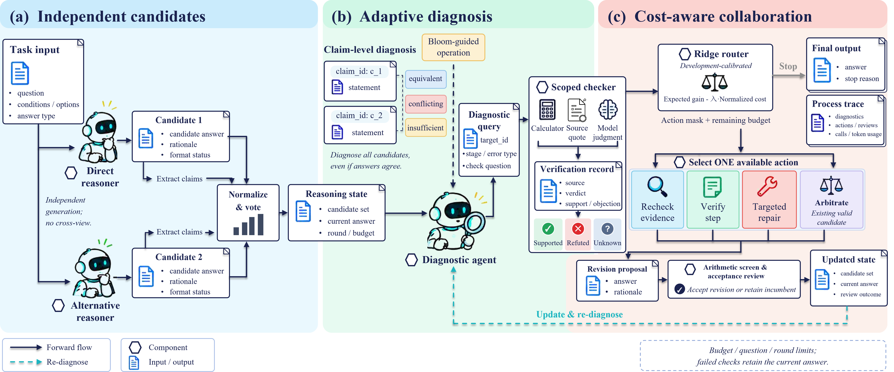

# DA²C

## Disagreement-Aware Adaptive Collaboration for Multi-Agent LLM Reasoning

[English](README.md) | [简体中文](README.zh-CN.md)

DA²C turns claim-level evidence into targeted collaboration. Adaptive diagnostic questions identify what needs checking, and a cost-aware router selects an intervention or stops. Reviewed revisions feed back into the next decision.

## Framework

1. **Generate independently:** two reasoners produce candidate answers and rationales.
2. **Diagnose and check:** Bloom-guided questions locate reasoning issues and gather verification evidence.
3. **Collaborate selectively:** the router chooses evidence rechecking, step verification, targeted repair, arbitration, or stopping.
4. **Review and update:** accepted revisions update the answer and trigger re-diagnosis.

## Paper Companion

- [Experimental overview](docs/experiments.md)
- [Key settings](docs/runtime.md)

## Code Release

The implementation, experiment configurations, and running and evaluation scripts will be released upon paper acceptance.

## License

Documentation and original figures: CC BY 4.0. Original software: MIT. See [LICENSE](LICENSE).
