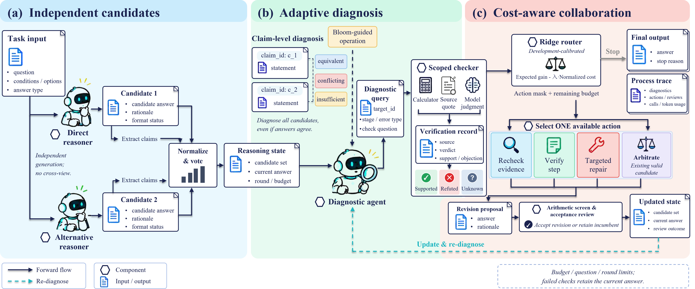

# DA²C

## 面向大语言模型多智能体推理的分歧感知自适应协作

**Disagreement-Aware Adaptive Collaboration for Multi-Agent LLM Reasoning**

[English](README.md) | [简体中文](README.zh-CN.md)

DA²C 围绕两个问题组织多智能体推理：**当前应该核查什么，以及哪一种协作动作值得执行？** 框架将陈述级自适应诊断与收益、成本感知的动作选择结合起来，使多个候选答案通过反馈驱动的协作过程得到核查与修订。

## 方法框架与核心流程

1. **独立候选生成。** 两个推理智能体独立读取原题，生成候选答案及简洁依据，经答案规范化和投票形成初始推理状态。
2. **自适应诊断。** 诊断智能体定位需要检查的陈述，以布鲁姆认知操作组织针对性问题；答案一致并不意味着跳过诊断。
3. **限定范围核查。** 区分受限计算、原题引用和模型判断，记录核查依据、来源及结论。
4. **成本感知协作。** 开发集校准的 Ridge 路由器比较预计正确性增量与 token 成本，在可用动作中选择补查证据、验证步骤、定向修订、已有候选仲裁或停止。
5. **审核与更新。** 修订提议经过接纳审核，更新后的状态再次进入诊断；达到停止条件、预算或轮数限制后，输出最终答案与过程轨迹。

## 实验说明

先阅读实验协议索引，再进入各主题页面。运行参数集中维护于配置文件，Prompt模板单独归档：

- [实验设置说明（简体中文）](docs/experiments.zh-CN.md)
- [Experimental settings (English)](docs/experiments.md)
- [运行及路由配置](configs/runtime.json)
- [Prompt模板](prompts/README.md)
- [发布、许可及快照](docs/release.md)

## 发布状态与时间安排

**当前状态：** 已提供双语说明、框架图、模型/路由配置及Prompt模板；当前材料不包含实验结果表。完整实现、拟合后的路由器及复现脚本计划录用后公开。

| 阶段 | 安排 |
| --- | --- |
| 项目说明 | 现已提供中英文 README 和方法框架图 |
| 实验材料 | 双语协议、配置元数据及Prompt |
| 实现代码 | 计划在论文录用后公开 |
| 实验复现材料 | 计划与实现代码一同发布 |

发布时间以论文录用为节点，目前未设定具体日期。材料发布后，将同步更新本 README。

## 计划公开的内容

- **实现代码：** 独立推理、自适应诊断问题链、限定范围核查、动作路由与修订审核。
- **可执行配置与产物：** 启动文件、拟合后的路由器、校准身份记录、基线及适配配置；说明性配置现已提供。
- **运行脚本：** 已支持实验流程的运行说明及执行脚本。
- **评估脚本：** 准确率、纠错与误改、token 用量、路由分析和结果汇总。

发布材料将说明基线适配方式，其中 **MAPS (text-adapted)** 为文本适配版，而非原多模态方法的完全复现。模型权重与第三方数据集遵循各自的访问条件和许可证；不发布私人凭据或本地部署密钥。

## 许可证

自有代码与原创Prompt采用MIT；文档、原创图表及汇总结果采用CC BY 4.0；第三方材料保留原许可。详见[授权范围](LICENSE)。
